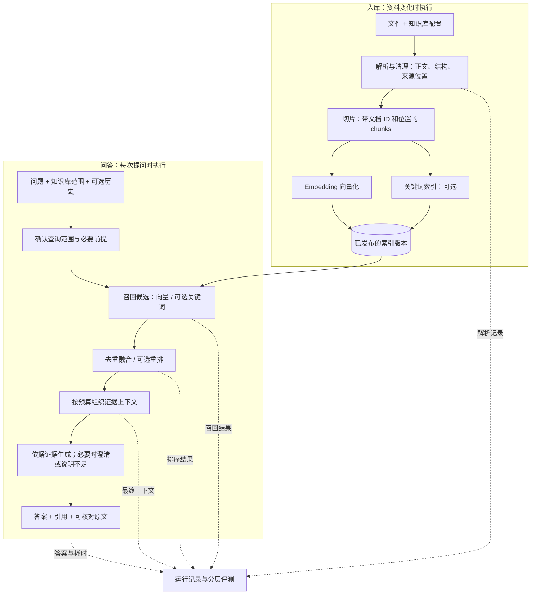

# 通用 RAG：流程、模块和评测路线

这一轮先建立整体认识，不执行新的模型评测或改动检索策略。售后与会计仍只是测试语料。

## 1. 整体目标与流程

RAG（检索增强生成）的基本过程是：从指定资料范围找出相关证据，再让模型依据这些证据回答，并返回可以核对的来源。通常不会因为导入文档而重新训练生成模型；导入阶段主要是在准备可检索的数据。

分为两条链路：资料变化时执行的**入库链路**，以及用户每次提问时执行的**问答链路**。以下为本项目拟采用的简化设计，不是 WeKnora 全部功能的逐行拓扑复现。

“必要时澄清”不是一个天然可靠的判断器：规则或模型都可能判断错误，必须单独评测。相似度高也不等于证据充分。

## 2. 每一步输入、处理与输出

| 模块 | 输入 | 中间处理 | 输出与保留信息 |
| --- | --- | --- | --- |
| 知识库与导入 | 文件、目标知识库、配置 | 分配文档身份、校验格式、记录版本 / hash | 文档记录、原文件、导入状态 |
| 解析 | PDF / TXT / Markdown 等文件 | 提取正文；处理段落、表格；扫描件需另配 OCR | 文本和结构、来源定位；仅保留解析器真实提供的页码 |
| 切片 | 解析后的正文和结构 | 按长度、段落或标题拆分，必要时重叠 | chunk_id、doc_id、正文、位置、可选元数据 |
| Embedding 与存储 | chunks、模型配置 | 将文本变成向量，写入隔离索引 | 向量、正文、元数据、可追溯的索引签名 |
| 查询准备 | 问题、知识库范围、可选历史 | 验证范围；需要时做指代消解或问题改写 | 检索问题、范围过滤条件；原始问题同时保留 |
| 召回 | 检索问题与索引 | 向量查语义相似；BM25 查词项匹配 | 候选 chunk 列表、分数、召回路径 |
| 融合 / 重排 | 问题与多路候选 | 去重合并；可选 reranker 逐一判断问题与片段相关性 | 更短、排序后的证据候选 |
| 上下文组装 | 排序结果、Token 预算 | 选片段、保留来源、避免重复；可选父段落扩展 | 真正送给 LLM 的上下文及来源编号 |
| 生成与返回 | 问题、上下文、提示词 | 根据证据作答，区分缺证据与缺少问题前提 | 答案、引用、澄清 / 资料不足说明；可检查原文 |
| 运行记录 | 每阶段输入输出和配置 | 记录模型、参数、版本、耗时、Token / 错误 | 可复现运行与失败定位依据 |

Embedding 用于把文本映射到可检索空间；reranker 用于重新排列已经召回的候选；LLM 用于组织答案。三个角色不能混为一谈。候选召回可比最终上下文宽，例如先找 20 段再选 4 段，但这是待验证参数，不是固定最佳值。

## 3. 参考 WeKnora 的具体部分

本次阅读腾讯官方仓库，固定版本 `bccb4b151bae403508da77fbb174efc79dc47c1a`。仅源码 / 文档分析，未部署 WeKnora、未复现其指标。来源哈希见 [weknora_sources.json](weknora_sources.json)。

- [chat_pipeline.go](https://github.com/Tencent/WeKnora/blob/bccb4b151bae403508da77fbb174efc79dc47c1a/internal/application/service/chat_pipeline/chat_pipeline.go)：Plugin / EventManager 将流程步骤组织为可注册的处理链。借鉴模块边界和分阶段错误，当前小项目不必照搬完整事件框架。
- [search.go](https://github.com/Tencent/WeKnora/blob/bccb4b151bae403508da77fbb174efc79dc47c1a/internal/application/service/chat_pipeline/search.go) 与 [rerank.go](https://github.com/Tencent/WeKnora/blob/bccb4b151bae403508da77fbb174efc79dc47c1a/internal/application/service/chat_pipeline/rerank.go)：召回与重排分开；未配置重排模型或调用失败时有回退路径，并记录诊断信息。借鉴“增强模块可关闭，失败后行为可解释”。
- [evaluation.go](https://github.com/Tencent/WeKnora/blob/bccb4b151bae403508da77fbb174efc79dc47c1a/internal/application/service/evaluation.go)：从评测数据中的 passages 建立临时知识、等待索引完成，然后运行问题，保存召回、重排与生成结果。借鉴可追踪的评测任务和准备过程；我们的题目、参考答案和评审文件仍不进入产品索引。
- [metric_hook.go](https://github.com/Tencent/WeKnora/blob/bccb4b151bae403508da77fbb174efc79dc47c1a/internal/application/service/metric_hook.go) 与 [evaluation 类型](https://github.com/Tencent/WeKnora/blob/bccb4b151bae403508da77fbb174efc79dc47c1a/internal/types/evaluation.go)：分别保存检索与生成指标，包含 Precision、Recall、NDCG、MRR、MAP 及 BLEU / ROUGE。当前 hook 优先用重排结果、为空时回退召回结果，并通过文本包含关系映射回 passage ID。我们不能只看指标名字就直接比较数值：片段粒度、来源映射、去重和分母必须先统一。

BLEU / ROUGE 可以作为文字匹配的辅助观察，不能单独决定中文文档问答的事实正确性或引用忠实性。改写可能文字不同却正确；只加一个“不”也可能文字高度相似但结论相反。我们的主要生成评测按语义要点与引用证据审阅。

## 4. 重要模块如何敲定

先固定一个可复现基线，再一次改变一个主要因素；不要同时更换模型、切片、Top-K 和提示词后把全部提升归给其中一个模块。

| 决策 | 起点 | 用什么实验决定是否改变 |
| --- | --- | --- |
| 解析器 | 复用支持文件类型的现有解析器 | 抽样核对原文，特别是扫描件、表格、标题和页码；正文漏失先修解析 |
| 切片策略 | 原 500 字符 / 50 重叠作已有对照，配置化 | 固定模型，比证据是否完整、检索噪声和最终上下文预算；字符数不等于 Token |
| Embedding | 继续使用已跑通模型作基线，配置化 | 在同一语料与题集上比召回、时延和成本；换模型需重建对应向量索引 |
| 向量库 | 当前 Chroma 足够验证本地功能 | 用实际数据量、过滤需求、更新成本与并发压测判断是否迁移；不能仅因框架采用其他库而更换 |
| 混合检索 | 作为可开关候选 | 看稀有词、编号及语义改写问题是否改善，报告退步类别；我们的售后 RRF 已出现退步 |
| 重排 | 留接口，先不作为必需前提 | 比召回后与重排后的证据保留、排名、最终答案及额外耗时；候选中没有证据，重排无法凭空补回 |
| 生成模型 / 提示词 | 当前模型，明确依据和引用 | 固定上下文比较要点、幻觉、引用、拒答与澄清；再测真实检索上下文 |
| 领域扩展 | 默认关闭，显式配置 | 单独报告其触发范围和收益；会计条号规则不能代表所有领域的通用提升 |

## 5. 评测是主线

### 5.1 先准备可信题目

每道题至少保存：问题、知识库范围、预期行为（回答 / 澄清 / 无法回答）、必需要点、证据在原文中的位置、版本要求及可替代的有效证据。不要只有一段“标准答案”而没有证据。

题目覆盖事实定位、语义改写、多证据、版本差异、歧义和无答案 / 无工具能力。知识库与问题都需要去重；根据共享证据或文档家族分组划分开发 / 测试，避免几乎相同的题目分居两侧。多个知识库分别报告，避免简单题较多的库掩盖另一个库的失败。

### 5.2 分层测，而不是只看最终答案

| 层次 | 主要问题 | 记录与指标 |
| --- | --- | --- |
| 数据 / 解析 | 原文是否完整，结构和位置是否正确？ | 原文抽查、关键字段保留、空解析 / 损坏文档比例、版本一致性 |
| 检索 | 正确证据是否出现，是否全部出现？ | 标注相关性的 Recall@K；证据单元覆盖、全部必要证据覆盖率；MRR / NDCG 作排序补充 |
| 上下文 | 找到了的证据是否被去重、截断、重排或预算丢掉？ | 召回池与最终上下文逐题对比，必要证据保留率、上下文 Token |
| 生成 | 是否正确覆盖问题要求？ | 必需要点正确性 / 完整性；遗漏与实质错误逐条记录 |
| 引用 | 引用原文是否真的支持该结论？ | 编号有效性、来源一致性；有证据支持的主张比例、需要引用的主张的引用覆盖率；不能只查编号存在 |
| 行为 | 资料不足 / 前提不明时是否处理正确？ | 无答案题拒答表现、歧义题澄清表现；同时测可回答题被错误拒答的比例 |
| 工程 | 是否稳定、可重现、开销可接受？ | P50 / P95 时延、错误率、Token / 请求费用；记录负载、缓存、重试条件；跨库与失败重建测试 |

Recall@K 的分母必须说明是相关 chunks、文档还是必要证据单元。切片策略变化时，优先保留原文证据单元的可比标注；不能拿不同 chunk 数的分母直接宣称提升。MRR 只关注第一个相关结果，多证据题首个命中很靠前也可能完全答不全。

我们的历史 96.77% 是会计开发集的**字符证据覆盖代理指标**，不是人工标注相关性的通用 Recall，也不是答案准确率。后续需要原文要点和语义审阅补充。

### 5.3 用错误路径定位该改哪个模块

以“退货有什么条件，怎样申请？”为例：需要条件和流程两组证据。检索只找到条件，答案只讲条件，是检索不完整；两组证据都进入最终上下文但模型遗漏流程，是生成问题；模型编造不存在的客服电话，是无依据主张。

实际排查顺序：

1. 完整语料本身是否有答案？没有则检查题目标注与正确的拒答行为。
2. 解析结果是否保留答案？没保留先修解析。
3. 候选召回池是否有证据？没有再查切片、Embedding 或词法召回。
4. 最终上下文是否保留证据？没有则查融合、重排、去重和预算。
5. 答案是否正确使用证据？有证据却答错，再查模型和提示词。

必要时把已标注的完整证据直接提供给生成器作**诊断对照**：如果仍答错，问题不只在检索。该结果不能混入真实端到端成绩；gold 仅用于这项明确标记的离线诊断。

### 5.4 如何让结果可信

- 固定并记录文档 hash、题集划分、代码 commit、模型标识、检索参数、提示词、上下文和答案；失败不从分母悄悄删除。
- 开发集用于选择方案；方案与标注冻结后运行保留测试集。看过测试失败再改动时，不再把同一测试成绩当成新的独立验证。
- 先助手初审 / 自动语法检查，再对语义和领域争议做人工复核。LLM-as-judge 可辅助，但需校准、抽查和争议裁定，不等于专家签署。
- 针对性失败样本不能估计总体准确率。随机性或样本数量可能影响小幅变化，应报告题数、分子分母，必要时重复运行和估计不确定性。
- 评测阈值是事先约定的目标，不是当前成绩。具体评分表见 [QUALITY_RUBRIC.md](../experiments/rag-baseline/evaluation/QUALITY_RUBRIC.md)。

## 6. 一步一步推进

1. **现在：建立全图。** 搞清两条链路、每个模块的输入输出和错误归因；对应本文件。
2. **下一步：追踪一个真实问题。** 展示一份导入文档如何变成 chunks，以及一个问题的候选、最终上下文、答案和引用；逐项解释如何判断对错。
3. **实现通用接入。** 动态创建知识库、导入新领域文档、生成文档身份并构建索引；验证无需改代码接入第三个库。
4. **建立开发集质量基线。** 审阅题目和证据，再按固定评分标准检查当前问答；20 题预选样本只做诊断。
5. **按失败类型逐项优化。** 切片、融合、重排、提示词分别实验，保留收益与退步。
6. **冻结与独立验收。** 运行保留测试、工程验证和演示，整理项目材料。

本次只完成流程解释与参考分析，未宣称已经部署 WeKnora、实现通用接入或完成质量验收。
