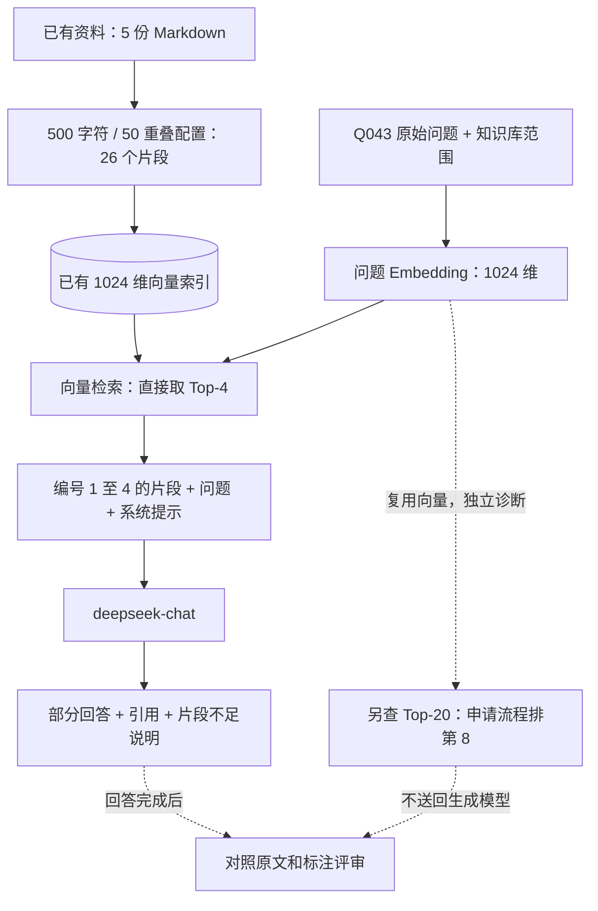

# 实践一：追踪一道真实问题

本次于 2026-10-07（Asia/Shanghai）调用实际 `KnowledgeService.query`，使用已有索引，执行一次问题 Embedding 和一次 DeepSeek 生成。没有修改应用检索策略、重建索引或运行保留测试集。售后资料只是通用 RAG 的一个测试场景。

问题：**买了十天的 X1 设置键故障，想直接无理由退款，该走什么流程？**（开发集 Q043）

结论：故障排查和退换政策进入了模型上下文，售后申请入口没有进入。模型给出了有依据的部分回答并说明片段不足，但用户需要的完整申请流程仍然缺失。该例展示了为什么“第一条检索结果正确”不等于“整道题回答完整”。

## 1. 先明确回答需要什么

按这份测试语料，问题需要三组证据。下表用于事后评估，不传给检索器或生成模型。

| 所需证据 | 原文位置 | 支持的回答 |
| --- | --- | --- |
| D1-S02 | X1 FAQ：设置键按了没反应 | 先检查电量、更换电池或强制重启，仍无效联系售后，不自行拆修 |
| D5-S03 | 售后政策：维修和退换的区别 | 十天超过该文档规定的七天无理由退换窗口；一年内非人为故障走保修维修 |
| D5-S06 | 售后政策：售后申请流程 | App → 我的 → 售后服务 → 选择产品和问题类型 → 填写故障描述 → 上传照片或视频 → 提交 |

这里复述的是测试文档中的政策，不能推广为所有产品的法律结论。“买了十天”也不能证明故障一定属于非人为损坏。题目标注状态为 `assistant_source_reviewed_human_pending`，仍待人工复核。

## 2. 实际输入、处理与输出



入库部分使用此前完成的产物：正文经切片后，每个片段保留 ID、来源与位置，再由 Embedding 模型编码并存储。本次从这个已有索引开始问答；500/50 是切片配置，不表示所有片段都恰好 500 字符或必定重叠 50 字符。

| 阶段 | 本次输入 | 处理与实际输出 |
| --- | --- | --- |
| 范围与索引检查 | `smart-home`、Q043 原始问题 | 使用该库的活动索引；5 份文档、26 个片段；模型与语料签名记录在 manifest |
| 问题向量化 | 原始问题，没有参考答案或证据 ID | `qwen3.7-text-embedding-flash` 输出 1024 维向量；约 1.31 秒 |
| 向量检索 | 问题向量、该库索引 | 按 L2 距离返回 4 个片段；约 0.010 秒 |
| 上下文组装 | 4 个命中片段、来源编号 | 四段全文均进入实际请求；本题没有单独的 BM25、重排或后续裁剪阶段 |
| 生成 | 系统要求、编号片段、原始问题 | `deepseek-chat` 生成答案；约 3.13 秒；服务端报告输入 1276、输出 372 Token |
| 返回 | 答案与来源信息 | 包含答案、引用、来源访问路径；整次服务调用约 5.07 秒 |

这里测的是一次直接服务调用，未包含浏览器或 HTTP 网络耗时；单次耗时不能代表 P50/P95。Embedding 和 LLM 的 Token 计费口径不同，上述 Token 仅来自生成调用。

## 3. 模型到底看到了什么

正式检索的四条结果如下。L2 距离越小表示在该向量空间越近，**不是答案正确概率**。

| 引用 / 排名 | 片段内容摘要 | L2 距离 | 对本题的作用 |
| --- | --- | --- | --- |
| [1] | X1 设置键排查、不要自行拆修 | 0.7552 | 覆盖故障排查证据 |
| [2] | X2 的设置键 / 触控屏与电池等说明 | 0.8817 | 型号不符，是本题的检索噪声 |
| [3] | 七天退换、一年保修、维修与退换区别 | 0.9061 | 覆盖政策证据 |
| [4] | X1 维修收费与其他常见问题 | 0.9062 | 补充非人为免费、人为损坏收费的条件 |

这说明纯语义相似会把“同样提到设置键，但属于其他型号”的片段排得很靠前。生成答案没有把 X2 的触控操作混进 X1 回答，但该片段仍占用了一个上下文名额。

实际发送结构：

```text
SYSTEM：只根据参考片段回答，关键结论标引用；区分产品型号和年份；
        多部分问题逐项回答，缺证据处明确说本次检索片段不足。
USER：
参考片段：
[1] 来源标题 + X1 排查片段全文
[2] 来源标题 + X2 片段全文
[3] 来源标题 + 政策片段全文
[4] 来源标题 + X1 维修片段全文
问题：买了十天的 X1 设置键故障，想直接无理由退款，该走什么流程？
```

以上是结构简写，完整实际请求见 [prompt.txt](../experiments/rag-baseline/evaluation/traces/smart-home/20261007T100145Z-295da35b/prompt.txt)。模型这次没有看到整个知识库，也没有看到 App 提交步骤。

## 4. 回答与评测：分别看完整性、依据和行为

原始回答见 [online.json](../experiments/rag-baseline/evaluation/traces/smart-home/20261007T100145Z-295da35b/online.json)，关键内容包括：

> 你已购买十天，超出 7 天窗口，因此不能走无理由退款流程。
>
> 7 天以上、1 年以内的非人为故障，应走保修维修（免费维修或换新）[3]。
>
> 片段未提供退款申请的具体操作入口、售后联系方式或工单提交路径，因此无法给出“具体在哪提交”的操作细节。

本次助手审阅结论（不是人工专家签字或整批质量分数）：

| 检查项 | 本例观察 | 如何解读 |
| --- | --- | --- |
| 必要证据覆盖 | 三组证据覆盖比例分别为 100%、100%、0%；平均 66.7% | 按同一来源中的规范化字符位置重叠计算；不是答案准确率 |
| 全部必要证据覆盖 | 否 | 一个完整办理问题仍缺申请步骤 |
| 第一条相关结果 | 排名 1，coverage reciprocal rank = 1 | 首条命中很好，也无法证明多证据齐全；这是单题倒数排名，不叫整批 MRR |
| 回答完整性 | 覆盖退换窗口、排查、条件性保修三项；缺 App 申请路径 | 四项预期要点中有一项缺失，不能判为完全解决 |
| 引用支持 | 主要政策、排查、费用说明可在 [1][3][4] 找到依据 | 编号存在只是格式检查；是否支持主张仍需读原文 |
| 缺证据时的行为 | 明说“本次检索片段不足”，未编造入口 | 行为合理，但用户任务依然未完成 |
| 表述可改进处 | “结论对你不利”多余；将售后工单与退款入口并列容易混淆；老化推测应谨慎 | 质量评审还应关注措辞、条件和推断强度，不能只算关键词 |

免费维修有“非人为”等前提；回答后文保留了这个条件，不能仅按“买了十天”直接承诺免费处理。上表只检查本次已观察到的回答，不推断其重复生成稳定性。

## 5. 错误发生在哪一层

回答结束后，我们复用同一问题向量，另外查询 Top-20，看到包含完整 D5-S06 的片段排第 8。诊断查询的前四条恰好与正式查询一致，但近似向量检索在不同 K 下不保证此前缀关系，不能把它当成普遍规律。

1. **资料有缺失吗？** 本题缺少的申请流程原文存在，切片也完整保留，因此没有发现这段证据的解析或切片丢失。
2. **正式检索选中了吗？** 没有。正式路径直接取 Top-4；申请步骤只在另一次更宽的诊断检索中出现。
3. **是送模型前被截断了吗？** 不是本例原因。四条正式命中全文都进入了模型请求。
4. **是模型看到了却忽略吗？** 对申请步骤而言不是，它没看到该证据。不能仅靠要求模型“回答得更完整”解决。

**本例定位到最终 Top-4 证据选择不足。** 尚不能从一个例子判断是更换 Embedding、扩大 K、重排还是拆分查询最有效，也不能证明这些方案在其他题上不会退步。

## 6. 下一步怎样做一个可信的改进实验

后续已完成 [实践二：Top-K 开发集对照](../experiments/rag-baseline/evaluation/TOPK_REPORT.md)，以下是从本案例出发制定的验证思路；实际收益、代价与剩余问题以该报告为准。

先用开发集比较 Top-4 与更宽召回，固定语料、Embedding、提示词与生成模型，分别记录：

- 必要证据是否更齐、全部证据覆盖是否改善，以及哪些题退步。
- 上下文长度、异型号或异版本噪声、引用是否仍然支持回答。
- 最终答案的完整性、无依据主张，以及耗时和 Token。

如果直接加大 K 改善覆盖但噪声和开销明显增加，再验证“较宽候选池 → 重排 / 去重 → 有预算的上下文”；这种比较必须同时记录候选与最终上下文，不能仅凭候选池覆盖变高宣称最终回答变好。多部分查询拆分可作为后续独立实验。所有策略都从问题和配置出发，不能写入 Q043 的标准答案或指定证据 ID。

保留测试集继续封存；单例用于解释机制，策略选择用开发集，最终成绩用冻结配置后的独立测试。当前两个领域分别报告，后续通过新领域导入检验通用性。

## 7. 如何复查与复现

本次工具 [trace_question.py](../experiments/rag-baseline/evaluation/trace_question.py) 在真实服务调用旁记录检索事件与实际模型请求；参考 WeKnora 分阶段记录的思路，但没有引入其事件框架或代码。具体来源与取舍见 [成熟项目参考](ARCHITECTURE_REFERENCES.md#adr-002开发集单题追踪)。

```bash
.venv/bin/python experiments/rag-baseline/evaluation/trace_question.py --kb smart-home --question-id Q043
```

需要已有可用索引和运行环境中的模型凭据；会发生真实模型调用。每次创建独立记录，不覆盖本次结果；线上模型可能有变化，重新运行不保证逐字相同。

本次记录目录：[20261007T100145Z-295da35b](../experiments/rag-baseline/evaluation/traces/smart-home/20261007T100145Z-295da35b/)。`manifest.json` 保存索引签名、程序 / 题集 / 输出哈希；`online.json` 保存正式路径；`prompt.txt` 保存实际请求正文；`corpus_chunks.json` 保存原始片段；`diagnosis.json` 保存事后证据对照与独立 Top-20 探查。文件不保存 API 密钥或认证头。
