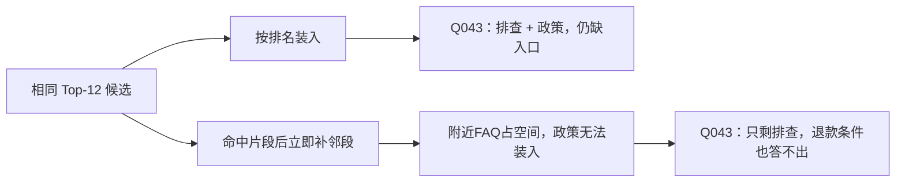

# 固定上下文预算：相邻片段扩展的收益与退步

日期：2026-10-07（Asia/Shanghai）。**简单地优先补齐每个命中片段的邻段，改善了会计条文覆盖，却显著降低售后题覆盖，因此不作为通用默认策略。** 本轮还定位到“上下文包含正确证据，但生成答案混淆相邻条款”的独立问题。

这是 [Top-K 实验](TOPK_REPORT.md) 的后续。应用默认行为未改；新增的是实验性上下文选择器、回放工具、测试和完整结果。知识库仍只是测试语料，规则没有写入型号、准则号、题目 ID 或标准答案。

## 1. 先诊断缺失证据在哪里

只分析上一轮保存的 Top-12，不重新请求 Embedding，不推断 Top-12 以外的确切名次。原文位置对照见 [context_missing_diagnosis.json](context_missing_diagnosis.json)。

| 问题 | Top-12 仍缺什么 | 与已命中片段的关系 |
| --- | --- | --- |
| ACC-Q041 | 分部报告第五条的后四项因素 | 位于第一名片段的下一段；原命中只覆盖条文约 44.6% |
| ACC-Q116 | 租赁现金流分类的第五十三条 | 位于第九名片段的前一段 |
| ACC-Q118 | 收入确认原则的第四条 | 位于第一名片段的下一段 |

这里的“下一段 / 前一段”指现有切片序列中的相邻 chunk，不保证恰好对应一个段落或条文。一个 chunk 可能同时包含前条尾部与后条开头，这是本轮生成错误的背景之一。

## 2. 固定方案后再运行

方案 [context_plan.json](context_plan.json)、实现 [context_budget.py](context_budget.py) 与 [context_experiment.py](context_experiment.py) 在运行前提交于 `207ba71`。

两个方案共用上一轮每题保存的 Top-12 候选及原始切片，最多装入 **2000 个片段正文字符**：

- `dense_budget`：依排名尝试装入完整片段，空间不足则跳过，继续尝试后面的较短片段。
- `neighbor_budget`：依排名先装种子片段；种子能装入后，尝试同来源的后一段、前一段，再处理下一名种子。邻段可来自原 Top-12 以外。按来源位置找邻居，不按领域规则找证据。

两者均去重 chunk ID、不截断片段、不合并重叠正文。标题、引用编号、问题与系统提示不计入这个字符上限，所以**同字符上限不是同 Token 预算**，实际 Token 另行记录。这只是第一组预算控制实验，尚非生产 Token 管理器。

共回放 128 道开发题、256 组上下文，0 次 Embedding；使用此前固定的 9 道可回答题，每题每方案生成一次，共 18 次真实生成调用。提示词与生成方法沿用应用，交替执行方案顺序；两个方案的输入均不同，因此实际无响应复用。SDK 可能重试，调用数表示逻辑调用数。

原始结果：[20261007T114837Z-81170bcc](context_runs/20261007T114837Z-81170bcc/)。生成样本不是随机抽样，不测重复生成稳定性，不估计总体准确率。97 道保留测试题未执行检索或生成。

## 3. 同预算下的结果

覆盖定义保持不变：每组必要证据被同来源规范化位置覆盖至少 80% 才计为已覆盖，先按题算覆盖组数比例，再对题平均。只计预期可回答题；其余 31 道开发题只参与上下文装配与长度统计。本表不是答案准确率。

| 语料 | 策略 | 平均证据单元覆盖 | 全部证据覆盖题数 | 平均正文字符（该库全部开发题） |
| --- | --- | ---: | ---: | ---: |
| 售后 | 按排名装入 | 97.22% | 28/30 | 1860 |
| 售后 | 优先补邻段 | 86.94% | 25/30 | 1841 |
| 会计 | 按排名装入 | 92.29% | 60/67 | 1870 |
| 会计 | 优先补邻段 | 95.27% | 63/67 | 1878 |

售后有 5 题覆盖下降（Q006/026/040/043/044），无改善题；会计有 5 题改善（041/059/098/114/118），2 题下降（075/084）。分类型结果和完整 ID 列表见 [summary.json](context_runs/20261007T114837Z-81170bcc/summary.json)。

会计条文定位 37 题的证据覆盖从 94.59% 提升到 100%，语义题 16 题却从 96.88% 降到 87.50%。仅报告条号题提升会掩盖真实退步。两个方案在该字符上限下的命中条数可不同，不能将 `dense_budget` 直接命名为 Top-4，虽然它本轮总体覆盖恰好与原 Top-4 相同。

固定 9 题的实际生成输入 Token：按排名装入 **11091**，补邻段 **11312**，约增加 **2.0%**。输出 Token 分别为 4963、4893；其中按排名组的 Q008 异常冗长，不能把汇总输出差异解释为稳定性能提升。两组都是约 2000 正文字符预算，成本控制比直接全部塞入 Top-12 更明确，但可能牺牲原本可用的证据。

## 4. 为什么会退步

Q043 原本需要故障排查、保修政策、申请入口三部分。优先扩展策略取入 X1 排查片段及邻段、X2 片段及邻段，导致排名第四的售后政策因剩余空间不足被跳过。记录中的 `decisions` 能直接显示跳过原因是 `budget`。



Q040 同样从能回答 X2/G2 退为只能回答 X2。这说明**同一文档的局部完整性与跨文档证据多样性会竞争预算**。片段相邻不等于对当前问题有用。

ACC-Q116 的现金流条文虽然挨着第九名命中，但前面的扩展已占用空间，第九名种子自己都未装入，也就没有机会扩展它。两方案仅覆盖 1/3 必要证据；“存在相邻关系”不足以保证低排名主题进入最终上下文。

## 5. 生成结果必须另审

[context_case_review.jsonl](context_case_review.jsonl) 保存 18 条助手初审，含回答摘录、所查引用、理由、完整性 / 引用忠实性 / 行为评分；人工评分仍为 null。评分沿用 [既有质量标准](QUALITY_RUBRIC.md)。`task_focus`、`context_displacement`、`contradictory_answer`、`generation_omission` 是本轮补充的诊断标签，不是新增自动判分规则。

| 案例 | 观察 | 应定位到的模块 |
| --- | --- | --- |
| Q040 / Q043 | 邻段挤掉其他型号 / 政策，回答明确证据不足 | 上下文选择；诚实说明不足仍不能完成用户任务 |
| ACC-Q041 | 邻段补齐第五条全部因素；回答却把第六条“地区分部”先归给第五条，末尾再纠正 | 生成中的条款归属矛盾；上下文条款边界也应改进 |
| ACC-Q059 | 补邻段后，回答实际增加了离职后福利、辞退福利等后半定义 | 检索与回答内容均改善；“概括”粒度的最终评分仍待人工裁定 |
| ACC-Q098 | 两版原文取齐，但两方案都额外断言养老保险的分类，当前所引片段未明确支持 | 引用忠实性，不能用外部常识替引用背书 |
| ACC-Q114 | 补齐两版第四条，回答了风险报酬与控制权差异，却未覆盖原标注中的五条件细节 | 生成遗漏 / 概括粒度复核，不能因检索齐全自动满分 |
| ACC-Q118 | 补齐确认原则，但计量仍缺；与上一轮 K12 只补齐计量形成不同缺口 | 多部分问题需要同时覆盖不同证据，单独补一端仍不够 |
| Q008 | 按排名组有正确证据，也回答了换手机，但同时输出 17 个 FAQ；补邻段组简洁回答 | 问题聚焦与生成稳定性，单次观察不证明策略因果 |

ACC-Q041 的实际原文与错误可直接对照：上下文 [2] 明确写 `第六条　地区分部`，回答却写“第五条还界定了地区分部”，最后又说“第五条仅规定业务分部”。**末尾纠正不能让前文矛盾自动消失；证据覆盖 100% 也不能算回答通过。** 本轮将该问题列为高优先级条款归属错误。

对于 ACC-Q059/098，继续保留上一轮的完整性评分歧义，不临时改变“概括”的要求来制造胜负。没有运行独立人工评审，不汇总所谓专家准确率。

## 6. 下一步的设计约束

本轮拒绝将“每个种子立即扩前后段”设为通用默认。保留这份负结果，避免在会计条文上看到收益就推广到所有领域。下一步优先验证：

1. **先比较问题相关性，再分配扩展预算。** 原始召回片段和拟补邻段一起成为候选，而非邻段先占满空间；重排作为独立可选步骤，记录其收益、退步、调用开销及失败回退。重排结果仍需评测，不能预设会提高质量。
2. **保留章节 / 条款边界。** 通用解析结果记录标题和结构单元，扩展到需要的结构边界；组装时让模型能区分“同一条的续文”与“下一条”。这种结构不能来自评测答案或固定准则号，也不能把所有语料先强行改成会计条文。
3. **分别检查三个位置。** 候选池有没有必要证据、最终预算是否保留下来、生成是否正确使用并归属引用。多证据问题还需覆盖各部分，而非只选多个语义相似的片段。

这些是待做事项；本轮没有接入 reranker，也没有完成通用文档导入改造。当前实验继续为通用流程设计提供依据。

## 7. 验证与复查

[context_audit.json](context_audit.json) 记录：原始运行及源码哈希一致、128 道均属 dev、256 组选择可重放、每组正文 ≤2000 字符、无重复 ID、邻段不跨来源、指标重算一致、18 次真实请求只含问题与引用资料、实际引用编号合法。**这些自动检查不代表语义质量通过。**

5 项新测试覆盖跨来源 / 版本隔离、源位置顺序、整片段预算、过大片段跳过、去重及邻段挤掉后续候选；连同既有基础评测共 16 项通过。所有原始生成响应与失败案例保留，没有筛掉不利结果。

```bash
.venv/bin/python -m pytest experiments/rag-baseline/evaluation/test_context_budget.py experiments/rag-baseline/evaluation/test_baseline.py -q
.venv/bin/python experiments/rag-baseline/evaluation/context_experiment.py --validate-only
# 以下会调用真实生成模型，使用已有 Top-K 记录；不会重新请求 Embedding。
.venv/bin/python experiments/rag-baseline/evaluation/context_experiment.py
```
