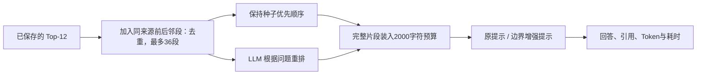

# 重排与边界提示：九题四组对照

日期：2026-10-07（Asia/Shanghai）。**重排在本轮九题中把全部必要证据选进了 2000 字符预算；生成仍有实质错误，LLM 重排的额外用量也较大。保留原型继续验证，暂不设为应用默认。**

这一轮回答两个问题：候选已经较全时，按问题相关性重排能否保留正确证据；在相同证据上增加片段边界与提醒，能否减少遗漏和条款误归属。它承接 [固定预算实验](CONTEXT_REPORT.md)，所有语料仍是通用系统的测试场景。

## 1. 做了什么，哪些因素保持不变

方案 [rerank_plan.json](rerank_plan.json)、实现 [rerank_context.py](rerank_context.py) / [rerank_experiment.py](rerank_experiment.py) 在调用前提交于 `05aafc2`。记录目录：[20261007T120512Z-c89f9fa3](rerank_runs/20261007T120512Z-c89f9fa3/)。



- 全部 128 道开发题先离线检查候选池覆盖；没有新的 Embedding 请求，没有修改索引。
- 候选池保留原 Top-12 在前，再按原种子顺序追加同来源的后一段、前一段，只扩一跳并按 ID 去重。不递归扩展，不跨文件或版本。不用 gold 定位、筛选或排序。
- 只有此前固定的 9 道诊断题调用重排与生成，保持售后 3 题、会计 6 题。该样本包含已知难题，不代表全部开发集分布。
- 两种排序共用同一候选池、2000 正文字符上限、完整片段装配方式；生成模型、基础系统提示与应用方法相同。上下文字符上限不含来源标题、系统提示、问题与边界标记，不是精确 Token 上限。
- 当前没有配置专用 rerank 模型；本轮使用已配置的 `deepseek-chat` 作 **LLM 列表重排原型**，输入问题、候选标签、来源和全文，输出全部标签的顺序。它不等于专用 cross-encoder 的性能或成本。
- 排序使用温度 0、最多 1024 输出 Token，要求 JSON 中每个候选标签恰好出现一次。非法结果或供应商异常回退原顺序并记原因；实际 9 次均有效，0 次回退。温度 0 也不保证远端模型严格确定性。

四组条件如下；每题生成一次，轮换执行顺序，没有挑选重试后的最好答案：

| 条件 | 排序 | 提示与上下文格式 |
| --- | --- | --- |
| `base_plain` | 种子优先，不重排 | 现有应用提示 |
| `base_boundary` | 与 base_plain 完全相同的片段和顺序 | 显式片段起止、来源位置、条号归属 / 截断 / 只答用户问题提醒 |
| `rank_plain` | LLM 重排 | 现有应用提示 |
| `rank_boundary` | 与 rank_plain 完全相同的片段和顺序 | 同上边界增强 |

边界增强同时包含格式与一组指令，不能把效果单独归功于某一个标记或句子。它保留原文已有 Markdown 标题，**没有解析章节树、继承标题或完整条款归属**。这项缺口在结果中直接暴露出来。

共完成 9 次重排、36 次生成。重排结果在两种提示条件之间共享；生成响应不复用。所有真实请求、排序结果和回答都保存，97 道保留测试题未运行。

## 2. 分清候选池覆盖和最终上下文覆盖

覆盖沿用此前定义：同来源规范化字符位置重叠去重，每组必要证据覆盖至少 80% 才计为覆盖。先按题算证据组覆盖比例，再取题目平均；不是回答准确率。

| 全部开发题的离线检查 | 可评分题数 | 扩充候选池中全部证据组达阈值 | 未重排、2000字符下全部达阈值 |
| --- | ---: | ---: | ---: |
| 售后 | 30 | 30/30 | 28/30 |
| 会计 | 67 | 67/67 | 60/67 |

其他 31 道开发题没有可回答证据标注，不计入此分母。完整候选池覆盖只是候选可用性的检查，不证明所有题都能在预算内装齐，更不证明模型会答对。

**以下重排结果只来自固定九题，不能与上表当作同一个样本比较：**

| 固定诊断样本 | 未重排的平均证据组覆盖 / 全覆盖题数 | 重排后的平均证据组覆盖 / 全覆盖题数 |
| --- | ---: | ---: |
| 售后 3 题 | 72.22% / 1/3 | 100% / 3/3 |
| 会计 6 题 | 22.22% / 0/6 | 100% / 6/6 |

提示词不改变所选证据，因此 plain 与 boundary 的检索指标相同。九题的原排序仅 1 题全覆盖，重排后 9 题均全覆盖：Q040 的四款型号资料、Q043 的售后入口、ACC-Q116 的确认与现金流条文、ACC-Q118 的确认与计量条文，都进入了预算。

这说明本轮已有候选池内的证据选择得到改善。尚未在剩余开发题上调用重排，也未评测无答案 / 澄清题的生成行为、排序位置偏差和重复运行稳定性，不能写成“全开发集重排达到 100%”。

## 3. 完整证据不等于完整、正确的回答

[rerank_case_review.jsonl](rerank_case_review.jsonl) 保存 36 条助手初审：核心要点、选定主张的来源检查、回答摘录和具体问题。人工评分仍为空，不将本轮汇总为整体答案准确率。评分标准沿用 [QUALITY_RUBRIC.md](QUALITY_RUBRIC.md)；概括粒度有争议的条文仍保留待裁定状态。

几个实际对照最能说明模块边界：

| 问题 | 本轮结果 | 结论 |
| --- | --- | --- |
| Q040：四款设备频段 | 重排后两组均给出四款直接支持情况；边界组还包含原标注要求的 G2 桥接限制 | 更好的证据选择帮助回答；是否要求桥接附加信息仍应人工裁定 |
| Q043：售后流程 | 重排普通提示覆盖排查与App入口；重排边界提示虽有全部证据，却漏写先检查电量 / 强制重启 | 加提醒不保证所有要点都被利用 |
| ACC-Q041：第五条 | 重排后的两组均正确拼合五项因素，没有上轮把第六条归入第五条的错误 | 本轮普通提示也答对，不能把改善独归于边界提示 |
| ACC-Q059：第二条续段 | 重排普通提示错误声称后半定义“不属于第二条”；边界提示改说无法确定归属，仍未概括续段 | 标记片段起止并未提供原文所属章节，结构元数据确实缺失 |
| ACC-Q098：两版比较 | 普通重排组仍有养老保险分类的无充分引文支持推断；边界组减少该推断，但也排除无标题续段 | 谨慎与完整性之间仍有取舍 |
| ACC-Q116：租赁现金流 | 重排后两组都回答了一般确认、可选简化和筹资 / 经营现金流分类 | 上一轮缺失的必要条文被选中，核心回答同步改善 |
| ACC-Q118：收入确认计量 | 重排后两组核心三项要点齐全，却把截断的第五条条件列表表述为充分条件 | 自发扩展的额外主张也必须审查，gold要点齐全不能判整答通过 |

ACC-Q118 的问题尤其关键。实际片段只含第五条第（一）至（四）项，[原文](../accounting/markdown/CAS-14-2017.md)还有第（五）项“企业因向客户转让商品而有权取得的对价很可能收回”。边界增强回答却说：

> 当企业与客户之间的合同同时满足第五条第（一）至（四）项条件时，企业应当在客户取得相关商品控制权时确认收入[1]。

这扩大了原文的适用范围。即使提示明确“列举被截断时不要声称已列全”，本次仍未避免错误。第五条并不是该题原标注的核心证据（核心是第四条、第十四条），但模型主动补充它之后，该主张同样需要验证。本轮将这类错误及第二条续段误归属列为高优先级问题。

Q008 还显示单次生成的波动：无重排普通组被资料中的 WiFi FAQ 带偏，边界组较聚焦；重排普通组主要回答正确，末尾却声称用户没有说明型号，实际问题已明确 X1。不能仅凭某一组某一次成功宣称问题彻底修复。

## 4. 整条链路的用量与时延

下表均为相同九题的合计用量；路径输入包含重排阶段和生成阶段，而非只看最终回答请求。Token 是服务端报告值，不等于货币账单，缓存及供应商计费未换算。

| 条件 | 生成输入 Token | 额外重排输入 Token | 路径总输入 Token | 路径总输出 Token |
| --- | ---: | ---: | ---: | ---: |
| 原排序 + 普通提示 | 11178 | 0 | 11178 | 3509 |
| 原排序 + 边界提示 | 14002 | 0 | 14002 | 3218 |
| LLM重排 + 普通提示 | 11149 | 59635 | 70784 | 4697 |
| LLM重排 + 边界提示 | 13906 | 59635 | 73541 | 4402 |

普通提示条件下，重排路径总输入是无重排的 **6.33 倍**，即使生成输入略少也不能说总体省 Token。排序本身还输出 636 Token。实验中九次排序被两种提示条件共用，没有实际重复支付两轮排序；上表分别表示选择其中一条路径部署时的逐题用量组合。

按每题实际“重排调用耗时 + 生成调用耗时”计算，普通提示无重排的中位数约 2.31 秒，重排约 3.80 秒。这里不含原始检索、浏览器、HTTP 与全部服务开销；只有九题串行样本、无预热、可含 SDK 重试，不是生产端到端性能指标。

## 5. 决策与下一步

1. **保留重排原型，暂不晋升默认。** 小样本说明相关性排序有价值；下一阶段仍需全开发集回归、无答案题与失败回退评测，再比较专用 rerank 模型或更低成本候选缩减方案。不能把当前 LLM 列表排序的收益 / 成本泛化为所有重排模型。
2. **优先补通用结构元数据。** 从原文解析章节路径、所属结构单元、续段关系及片段是否截断结构单元；在来源信息中保留真实边界。字段应来自解析结果，不能用评测 evidence ID 或固定会计条号填充。无法可靠识别时应明确未知。
3. **把额外主张纳入质量评测。** 不只检查标准答案要点；任何模型主动补出的适用条件、条款归属、操作步骤都要有完整证据。概括粒度与替代证据争议继续人工裁定，不为配合实验成绩修改历史 gold。

本轮边界提示只是实验条件，结构解析尚未实现；通用文档导入和知识库注册的既定目标继续保留。下一步应把结构信息落实到通用文档 / chunk 数据模型，再以固定实验集检查续段误归属和条件截断，而不是把本轮提示词当作完成方案。

## 6. 核验与复现

[rerank_audit.json](rerank_audit.json) 验证了候选池原始记录与源码哈希、开发集隔离、九题预选名单、重排精确排列、同排序两组的证据完全相同、2000 字符预算、实际提示重建、指标重算和引用编号格式。文号 `财会[2006]3号` 等单独识别，不误当引用编号；文号出现本身不证明每项主张的语义支持。

27 项测试通过：候选只扩一跳且不跨来源、预算及去重、非法 / 缺失 / 重复排序标签回退、边界格式保留原文、供应商异常回退且不记录异常体。真实运行未触发回退，不能把单元测试当作线上故障统计。

```bash
.venv/bin/python -m pytest experiments/rag-baseline/evaluation/test_rerank_context.py experiments/rag-baseline/evaluation/test_context_budget.py experiments/rag-baseline/evaluation/test_baseline.py -q
.venv/bin/python experiments/rag-baseline/evaluation/rerank_experiment.py --validate-only
# 以下调用真实模型：9次排序、36次生成；不请求Embedding。
.venv/bin/python experiments/rag-baseline/evaluation/rerank_experiment.py
```
