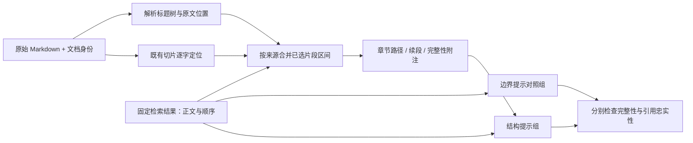

# 实践五：让片段携带章节归属与完整性

本轮完成通用原文结构模块，并固定九题正文做了 18 次真实生成。结构提示让第二条续段归属更明确、让被截断的第五条条件得到明确提示；同时出现漏答、分类组织错误和片段外常识，输入 Token 增至对照组的 **3.15 倍**。保留为实验能力，暂不接入应用默认生成。

## 这一步在 RAG 中解决什么

检索返回的 chunk 是字符切片，不一定是完整语义单元。例如一个片段以“离职后福利，是指……”开头，上一片段才有“第二条”标题；模型只看到正文时可能不知道这段属于哪里。另一个片段在五项条件的第四项后结束，片段结束并不代表条文结束。



| 模块 | 输入 | 处理 | 输出与边界 |
| --- | --- | --- | --- |
| `rag/structure.py` | 原文、通用文档身份、格式配置 | ATX / 单行 Setext 标题、围栏代码排除；可选独立加粗行 | 文档 hash、标题树、原文字符和行位置；不接受 gold 或领域配置 |
| 原文定位 | 原文及原始顺序的切片正文 | 字面匹配，允许重叠 | 左闭右开 Unicode 字符位置；匹配失败时报错，不伪造位置 |
| 片段注释 | 已选同文档片段区间 | 按直接所属标题分块，并合并区间判断完整性 | 续段、后续内容是否缺失、整个章节含子节是否覆盖；未知结构返回 null |
| 模型输入组装 | 不变的正文、引用及结构注释 | 加入位置与解释指令；标题最多摘录 32 字，且必须已在选中正文里 | 不补充未检索条文；内部审计可存完整标题，但模型只能看到已选文字 |
| 评测 | 两组实际请求、回答、原文和候选标注 | 自动检查输入不变；助手逐题语义审阅 | 技术审计与答案质量分开；人工评分仍为 null |

“章节完整”只表示识别出的原文章节被选中正文覆盖，不证明其事实正确或现行有效。当前是保守 Markdown 子集，不是完整 CommonMark，也不识别所有普通文本小标题。加粗行识别为启发式；PDF / TXT 等未提供结构时归属未知。通用文档注册与导入改造仍待完成。

## 实验如何控制变量

运行：[20261007T130324Z-65ea2859](structure_runs/20261007T130324Z-65ea2859/manifest.json)。预先保存 [计划](structure_plan.json)，沿用实践四 `rank_plain` 的九题已选 chunk，正文、顺序、引用、2000 字符正文上限全部固定。

- `boundary`：重新调用模型，使用实践四边界与任务聚焦提示。
- `structure`：相同提示和正文，新增结构 JSON 与字段解释指令。
- 每题每组一次，交替执行顺序；实际使用 `deepseek-chat`，18 次生成、0 次 Embedding、0 次排序，不复用旧回答。
- 这是“元数据 + 解释指令”的联合干预，未分别隔离两者贡献；九题是开发诊断选样，不是随机样本，没有重复试验稳定性结论。
- 两组每题所需证据均达到既有覆盖阈值，9/9 不变；这个指标不是答案准确率。97 道保留测试题未执行。

## 逐题结果：目标改善也不等于整题通过

全部 18 条助手审阅记录见 [section_case_review.jsonl](section_case_review.jsonl)，含原句、来源判断、维度评分和争议。题目标注仍待领域人工裁定，不给总体“准确率”。

| 题目 | 本轮边界组 | 本轮结构组 |
| --- | --- | --- |
| Q008 换手机 | 同账号、无需配对、蓝牙重连齐全 | 同样齐全 |
| Q040 四型号网络 | 四款及桥接限制齐全 | 同样齐全 |
| Q043 设置键故障 | 政策、排查、维修、App 流程齐全 | 漏掉检查电量和强制重启，虽然证据已在上下文 |
| ACC-Q041 分部报告第五条 | 定义与五因素齐全 | 同样齐全，不能归因于新结构 |
| ACC-Q059 职工薪酬第二条 | 只详述前半，称后续术语相关；未明确排除续段，概括细度有争议 | 续段完整归回第二条；但“四类”标题下列五项，把带薪缺勤插作并列项，组织误导 |
| ACC-Q098 两版第二条 | 核心差异正确，续段归属不够明确 | 归属更明确，但又写出片段未支持的养老保险分类常识，且暴露内部字段 |
| ACC-Q114 两版收入第四条 | 五条件与控制权原则区分正确 | 同样正确 |
| ACC-Q116 租赁 | 确认、可选简化、现金流三组齐全 | 核心齐全，但增加未问的披露缺失说明，偏冗长 |
| ACC-Q118 时点与金额 | 核心三点齐全；主动列第五条仅前四项，未提醒不全 | 明确“可见片段未列全第五条全部条件”；末尾“现行”措辞缺效力核验，仍不能整题判满分 |

ACC-Q059 的结构注释把两段指向同一章节 ID，按两段合并计算该条完整性为 true。这里不需要补充任何定义正文。ACC-Q118 的第五条完整性为 false，结构组因此能承认列举不全，也没有凭空补出缺失第五项。正式产品更应优先回答问到的第四条与第十四条，减少无关展开。

与上轮历史回答不同，本轮边界组没有明确断言“续段不属于第二条”；因此不能把本轮模糊概括硬判为同一种旧错误。原始回答和失败记录全部保留，不调整 gold 来凸显收益。

## 开销

| 九题合计 / 中位数 | 边界组 | 结构组 |
| --- | ---: | ---: |
| 生成输入 Token | 13,906 | 43,807 |
| 生成输出 Token | 3,700 | 4,052 |
| 生成调用耗时 p50 | 2.37 秒 | 2.52 秒 |

结构附注增加 29,901 输入 Token（+215.0%）。当前 JSON 重复携带祖先路径、hash、位置和字段名，明显过重；完整审计对象不应直接等同于生产提示格式。这里计的是生成调用，不含历史检索和排序成本，不是端到端 SLA 或费用估计。

## 验证与复现

- 64 份文档、775 个切片逐字定位与规范化位置一致；结构快照可按原文重算。
- 40 项应用测试、44 项评测工具测试通过；含 10 项结构核心、2 项元数据泄露与来源隔离测试。
- [自动审计](section_audit.json) 核对实际请求、相同正文顺序引用、标题可见性、证据指标、输出 hash 及运行提交中的代码 hash。
- 原运行提交为 `21f46a9`。新脚本当时名为 `structure_experiment.py`，运行后更名为 `section_experiment.py`，恢复此前同名的结构检索实验入口。历史原始 manifest 不改写，审计从其记录的 Git 提交校验代码，不用当前同名文件冒充运行版本。

仅离线验证（不调用模型）：

```bash
.venv/bin/python experiments/rag-baseline/evaluation/section_experiment.py --validate-only
.venv/bin/python experiments/rag-baseline/evaluation/audit_sections.py
```

实际重新生成：运行 `section_experiment.py` 不带参数，会新建运行目录并调用 18 次模型。

## 下一步

先将内部审计结构和模型提示分离，给模型只保留必要的片段分块、短章节标识、标题摘录与完整性，设置包括元数据在内的 Token 预算。随后把稳定的文档身份、原文位置与结构元数据接入通用导入流程，用第三种语料验证无需修改核心代码即可导入和查询。全面检索重排评测、独立保留测试及人工领域验收仍未完成。
