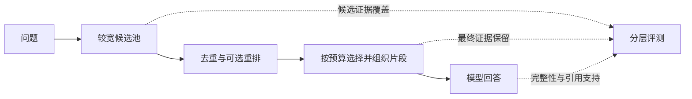

# Top-K 开发集对照：更多片段能解决什么

日期：2026-10-07（Asia/Shanghai）。**扩大 K 提高了本轮证据覆盖，但不能解决所有遗漏，也不能保证回答更好。暂不修改应用默认检索策略。**

## 1. 实验范围与控制

运行记录：[20261007T110838Z-70f47b9c](topk_runs/20261007T110838Z-70f47b9c/)。实验方案 [topk_plan.json](topk_plan.json) 和工具 [topk_experiment.py](topk_experiment.py) 在调用模型前提交，commit `4d97f40`。

- 两库全部开发题：售后 43、会计 85，共 128；每题分别查 Top-4、8、12，共 384 组检索。
- 复用已有索引，固定 500/50 切片、L2 距离、Embedding 模型与语料；每题三个 K 共用同一个问题向量，分别执行 Chroma 查询。8 批问题 Embedding，无索引重建。
- **纯向量检索实验，未执行应用的型号澄清、会计条号定位等领域规则。** 因而不是当前完整应用路径的验收，也不能拿本轮会计指标直接替换已有领域路由指标。
- 生成样本为此前 `quality_sample.json` 中所有可回答题：售后 Q008/040/043，会计 ACC-Q041/059/098/114/116/118。每题每 K 生成一次，共 27 次；沿用应用 `KnowledgeService.generate`、同一系统提示与 `deepseek-chat`，全部命中进入上下文。轮换 K 的执行顺序，未做重复生成稳定性检验。
- 题目标签只用于选定评测样本与事后评分，不传给检索或生成。97 道保留测试题没有执行检索或生成。
- 模型服务使用公开配置的模型别名；固定参数与保存响应不能保证远端权重不变或日后逐字重现。上一轮单题与本轮重新请求的向量排名可有小变化，本轮只作同次运行内配对比较。

## 2. 先看检索覆盖

只有预期 `answer/flag_conflict` 的题计入必要证据覆盖：售后 30、会计 67。其余 31 道澄清 / 无答案题也执行检索并统计上下文长度，但没有给它们虚构“正确证据”，也没有在本轮测生成行为。

一组标注证据在同来源的规范化字符区间被命中片段合计覆盖至少 80%，才记为“该组证据已覆盖”；重叠位置去重。每题指标为 `已覆盖组数 / 必要组数`，再对题目取平均。“全部覆盖题数”要求该题每组都达阈值。**这是证据单元覆盖，不是字符覆盖比例的简单均值，也不是最终答案准确率。**

| 语料 | K | 平均证据单元覆盖 | 全部必要证据覆盖题数 | 多证据类平均覆盖（各 5 题） |
| --- | ---: | ---: | ---: | ---: |
| 售后 | 4 | 97.22% | 28/30 | 83.33% |
| 售后 | 8 | 98.33% | 29/30 | 90.00% |
| 售后 | 12 | 100.00% | 30/30 | 100.00% |
| 会计 | 4 | 92.29% | 60/67 | 56.67% |
| 会计 | 8 | 95.77% | 63/67 | 73.33% |
| 会计 | 12 | 97.26% | 64/67 | 83.33% |

相对 K4：K8 改善售后 Q043，以及会计 059/084/114/116；K12 改善售后 Q040/043，以及会计 059/084/098/114/116/118。未发现覆盖指标下降。本次不同 K 的结果前四条全部相同，所以这种“不下降”符合覆盖指标在追加片段时的单调性，**不能证明增加片段没有噪声或生成副作用**。近似检索不普遍保证不同 K 前缀一致。

## 3. 多拿片段的代价

| 观察量 | K4 | K8 | K12 |
| --- | ---: | ---: | ---: |
| 售后平均片段正文字符数（43 题） | 1646 | 3291 | 4886 |
| 会计平均片段正文字符数（85 题） | 1689 | 3383 | 5100 |
| 固定 9 题实际生成输入 Token 合计 | 10298 | 19050 | 27454 |
| 同一批回答输出 Token 合计 | 3702 | 3539 | 4370 |

K12 上下文正文约为 K4 的三倍；固定样本生成输入 Token 为 **2.67 倍**。字符数不等于 Token，实际请求还包含来源标题、问题和系统提示。Token 增长表示用量增长，未据此估算货币费用（缓存与供应商价格尚未核算）。

各组生成耗时及 P50/P95 保存在 [summary.json](topk_runs/20261007T110838Z-70f47b9c/summary.json)。每库每 K 仅 3 或 6 次串行生成，输出长度不同，含网络与可能的 SDK 重试；这些小样本分位数不是生产性能结论。本轮没有完整的片段相关性标注，不报告检索 Precision 或“噪声率”。

## 4. 回答是否跟着变好

逐条阅读实际回答、引用与原文，按 [质量标准](QUALITY_RUBRIC.md) 保存了 [27 条助手初审](topk_case_review.jsonl)，含回答摘录、检查的引用、理由及问题标签。人工评分仍为 null。以下聚焦可核对的变化，不把针对性样本汇总成总体准确率。

| 题目 | K4 | K8 | K12 | 说明 |
| --- | --- | --- | --- | --- |
| Q008：换手机控制门锁 | 三项要点齐全 | 齐全 | 齐全 | 原本就答全，多片段增加用量 |
| Q040：四款设备的 WiFi 频段 | 缺 X1/C1 | 仍缺明确证据 | 四款均答全 | 多证据题确有改善 |
| Q043：十天故障售后流程 | 缺 App 申请入口 | 补齐入口与材料步骤 | 同样补齐 | 对上一轮遗漏作了实际对照验证 |
| ACC-Q041：第五条因素 | 条文后四项缺失 | 仍缺 | 仍缺 | 加至 12 仍没检索到后半条文 |
| ACC-Q059：第二条概括 | 条文只取到 51.1% | 已取到全文，仍主要回答前半 | 同样主要回答前半 | 概括粒度没有细标，完整性待裁定 |
| ACC-Q098：两版第二条 | 主要比较已回答，2014 后半缺失 | 同样主要比较 | 两版已取齐，仍有扩展推断 | 覆盖提升不等于所有主张都有引用支持 |
| ACC-Q114：两版收入第四条 | 缺 2017 规则 | 补齐对比 | 同样完整 | 较清楚的检索和回答同步改善 |
| ACC-Q116：租赁与现金流 | 缺一般确认与现金流条文 | 补齐一般确认，缺现金流 | 仍缺现金流分类 | 更多相关资料无法代替特定必要规则 |
| ACC-Q118：确认与计量 | 核心规则不足 | 核心规则仍不足 | 补齐计量，普遍确认原则仍未讲清 | 需核对可替代证据，不能机械只看指定条号 |

几个值得单独学习的问题：

**引用编号有效，不等于主张有依据。** ACC-Q098 的 K4 回答写“这两类在2014版框架下应属离职后福利等类别”，K12 写“这与2014版把养老、失业等归入‘离职后福利’的分类框架有关”。这两次输入的 2014 片段都没有明确支持该分类；完整原文或外部常识不能替本次引用背书。K12 还把比较财务报表信息的过渡规定扩展为“衔接上并不要求追溯重述”，范围应收紧。观察到该问题不代表已证明它由扩大 K 导致，单次随机生成不足以建立这种因果关系。

**“答得少”和“答错”要区分。** ACC-Q041 三个 K 都只获得第五条约 44.6%。K8/12 说明只展示部分原文，属于诚实但不完整。K4 在承认缺失时还列举“如产品或劳务的客户类型、销售方式等”，这些具体后续因素未出现在本次片段，仍属无充分引用支持的补充。

**评测题也要审。** ACC-Q059/098 对“概括 / 分别说明”的必需粒度没有充分细化；完整性分暂留 null，不临时把“必须复述全文”加成更严标准。ACC-Q118 的第十三条控制权迹象可能支持部分替代论述，需要人工判断与第四条原则的关系。历史 gold 和本轮覆盖结果保持原样；后续修订需版本化并给出前后差异。

**格式检查也会错。** 最初简单的 `[数字]` 正则把 ACC-Q118 K4 中的文号“财会[2006]3号”当作引用 2006。核对实际来源后归为文号。最终真实引用编号检查通过，但这只检查格式；语义支持仍以逐条审阅为准。

## 5. 决策及下一步

后续已完成 [固定预算与邻段扩展实验](CONTEXT_REPORT.md)：用相同的 Top-12 候选对照 2000 字符预算，发现简单优先扩展导致跨领域退步。以下保留本轮制定后续实验时的思路。

本轮验证了“较宽检索有助于多证据召回”，没有证明 K12 应成为通用默认值。保留当前应用策略，本轮改动仅在实验工具、原始结果和文档。

下一步把**候选召回数量**与**最终上下文预算**分开：



先定位会计剩余三个未全覆盖题（041/116/118）的缺失片段：如果候选池没有，重排不能凭空补回；长条文尾段问题可考虑通用的相邻片段 / 父段落扩展，多意图问题可单独验证查询拆分。若已在候选池，再比较重排、去重及预算选择能否保留必要证据，并控制生成输入长度。每个改动独立消融，不能同时改模型、提示词和切片后把收益归给某一个模块。

同时细化歧义标注及可替代证据，增加独立领域导入验证。现有售后和会计继续作为测试语料，不能把固定型号或准则规则写进通用核心。保留测试集待方案冻结及人工复核后再使用。

## 6. 核验与复查

- [topk_audit.json](topk_audit.json)：128 题、384 组检索、27 次生成的来源与输出哈希、索引签名、指标重算、实际请求和引用编号核验；记录文号误报及处理。
- 原始 `results.jsonl` 保存每种 K 的命中 ID / 距离、实际消息、答案、引用、Token 与耗时；两份 `*-chunks.json` 保存片段快照。
- `manifest.json` 保存源码 / 方案 / 题集哈希、Git commit、索引版本与模型配置；不保存认证信息。11 项已有基础评测测试通过，文档与结果另做完整性核验。

复现会发生真实模型调用：

```bash
.venv/bin/python experiments/rag-baseline/evaluation/topk_experiment.py --validate-only
.venv/bin/python experiments/rag-baseline/evaluation/topk_experiment.py
```
